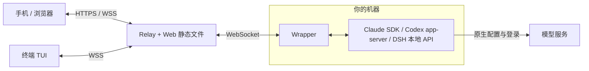

# cc-remote

**用手机、浏览器连接本机的 Claude Code、Codex 与 DSH。**

自托管 · 多会话 · 多设备 · 实时工具过程 · Code / Work · Web / PWA / TUI

**产品版本：v5.3.7** · Wire protocol v85

[English](README_en.md) · [Release 安装（推荐）](#安装与升级) · [功能对照](#引擎与功能) · [源码体验](#快速开始) ·
[界面导览](#界面导览) · [终端工作台](#terminal-workspace) · [文档](#文档) · [更新记录](CHANGELOG_zh.md)

cc-remote 把本机 agent 的会话、工具过程、文件和运行控制带到远端。你可以在电脑上
开始任务，用手机查看进度、回答询问、补充指令，再回到原来的会话继续工作。
模型登录、供应商配置和工具执行仍由本机引擎负责；cc-remote 不代理模型 API。

**推荐普通用户部署最新稳定 Release。** 按照 [Release 安装指南](docs/installation.md#release-install)
完成首次安装后，即可在独立终端或 SSH 中执行 `cc-remote update`，一键更新到最新稳定版。
安装和更新使用预构建产物，无需自行克隆源码、运行 CI 或构建前端。

本文说明当前源码的能力。安装已发布包时，请阅读对应 tag 的文档；产品版本号相同，
也不代表不同提交的功能和协议相同。


本文截图由 computer use 从 cc-remote Desktop 实际截取，使用 v5.0.0 Web 界面与隔离的
合成演示数据；项目、路径、设备、对话、额度和运行结果均不来自真实用户。更多功能见[界面导览](#界面导览)。

## 可以做什么

- **同时处理多个任务**：会话按目录分组，支持搜索、置顶、重命名和后台运行。
  切换页面不会停止任务；历史按需加载，工具细节展开后再读取。
- **跟进完整过程**：查看流式回复、引擎公开的思考摘要、计划、工具调用、命令输出、
  文件改动和审批。Claude、Codex 与 DSH 运行中均支持引导或排队；引导会补充当前任务，不会打断正在执行的工具。
- **管理长任务**：通过 `/goal` 设置目标，查看进展并使用各引擎原生的预算与控制。
  Claude、Codex 还支持 `/btw` 临时侧聊，主任务继续运行。
- **直接查看文件**：聊天里的文件和目录链接连接到 `/open` 与预览面板，支持源码、
  Markdown、图片、HTML、PDF、音频和 XLSX。
- **连接多台机器、多个账号**：设备中心提供配对、切换和撤销；内置 Claude/Codex
  多账号支持，可在同一界面使用 OAuth 登录账号和中转站 API 账号。
- **调整阅读外观**：更多设置 → 外观，可调整强调色、背景色、文字色与字体。每个引擎的浅色／深色分别在当前浏览器保存，也可恢复当前配色的默认值。
- **适合手机使用**：紧凑的引擎菜单、明暗主题、图片缩放、PWA 和可选后台通知。
  通知默认只显示通用状态，显示会话名称需要主动开启。
- **也能在终端继续工作**：全屏 TUI 支持 Claude/Codex 的 Code / Work，共享网页
  会话、运行状态和队列；提供 Vim 风格操作、会话树、标签与工具详情。
  [安装与启动](#terminal-workspace)。

### Code 与 Work

**Code** 面向你选择的项目目录，用于开发、调试和日常 agent 任务，支持 Claude、Codex 和可选的 DSH。

**Work** 是 Claude/Codex 的独立工作区，适合文档、表格、演示和资料整理。它有私有
项目、文件／链接／笔记资料库、工作模板、Artifacts，以及一次、每日、每周定时任务。
每项工作使用独立目录，需要的材料通过附件或资料库加入。Work 的会话、资料与 Code
分开。

## 引擎与功能

v5.0.0 新增可选的 **DSH 0.2.1-rc.2** 接入，使用现有 Code 聊天界面与独立的白蓝默认配色。
支持原生命令、Skills、询问与审批、引导/排队、Goal、子代理、后台任务和产物预览。
安装配对、验证方式与原生功能边界见 [DSH 接入说明](docs/dsh-integration.md)；
模型认证仍由 DSH 管理，接入不会自动升级或迁移现有 DSH 数据。

下表描述 **cc-remote 已接入的能力**。模型、权限和扩展目录仍以所选设备上的原生
引擎为准。

| 能力 | Claude Code | Codex | DSH |
|---|---|---|---|
| 接入方式 | 日常 Claude CLI + Agent SDK | 官方 app-server，共享 daemon | 原生本地 API，独立配对 |
| Code / Work | 两者支持 | 两者支持 | 仅 Code |
| 全屏终端 TUI | 支持 | 支持 | 暂不支持 |
| 模型与思考 | 原生模型与支持的档位 | 原生模型、思考强度、服务档位 | 原生模型、推理档位、权限与模式预设 |
| Plan | 原生 Plan 模式 | 原生 Plan 协作模式 | 原生命令；以当前预设目录为准 |
| Goal | 完成条件、检查轮次、最近检查结果、Token 用量和耗时 | 目标、可选 Token 预算、暂停／继续、完成和清除 | 目标、轮次上限、暂停／继续、完成和清除 |
| `/btw` 临时侧聊 | 支持 | 支持 | 暂时禁用，等待官方删除能力 |
| 归档与删除 | 归档、恢复、删除 | 归档、恢复、删除 | 归档、恢复；不支持删除 |
| 会话派生 | 支持 | 支持；可派生到独立 worktree | 原生持久化派生；不支持 worktree |
| 文件差异 | 项目 Git Diff、逐轮改动记录 | 项目 Git Diff、逐轮改动记录 | 项目 Git Diff、原生逐轮快照；已释放且未保存的旧快照不可恢复 |
| 特有工具 | Hooks 管理、原生询问与工具审批 | Review、空闲会话目录迁移、状态与账号限额 | 子代理、后台任务、工作流、执行轨迹、终端与自动化 |
| 扩展 | Skills、插件、MCP、Hooks 等，按能力管理 | Skills、插件、Apps、MCP；Hooks 只读 | Skills、本机插件与插件包；插件市场暂不可用 |

### Goal 的预算不是上下文窗口

`/goal` 打开当前引擎的目标小窗，三种引擎的控制分别对应原生能力：

- **Claude** 使用完成条件和原生检查反馈；展示用量与耗时，没有 Codex 式 Token 预算输入。
- **Codex** 可设置目标累计 Token 预算，或不设预算；预算不用于扩大上下文窗口。
- **DSH** 使用原生轮次上限和自动续行状态，可暂停、继续、完成或清除；不是 Token 预算。

### DSH 的会话工具

在 **更多 → DSH 会话工具** 中，按用途切换子代理、后台任务、工作流、执行轨迹、
产出文件、自动化、运行设置、插件、预设、终端和连接诊断。

- **模式**：新建会话时选择标准、PTC、极简或创造模式；可用项来自本机 DSH，当前模式显示在页面 `Code` 旁。
- **子代理与任务**：查看原生执行过程；支持控制的子代理可继续提问、引导或停止，旧格式会话可能要先在官方客户端迁移。
- **终端**：直接使用设备上的交互式终端，支持滚动、Ctrl+C 中断、重连和关闭。收起面板保留终端；这些命令由用户直接执行。
- **自动化**：通过表单选择目标会话、重复规则与时间，也可通过对话创建。投递记录表示消息已送达，任务结果仍在目标会话中查看。
- **运行设置与扩展**：按原生接口的生效范围保存参数，管理本机插件与插件包；需要重启的修改保留到下次启动。

**当前边界**：DSH 仅支持 Code；官方尚未提供适用的会话删除与插件市场能力。
侧聊菜单、快捷键和 `/btw` 已禁用，等待官方能力完善后再接入。归档只隐藏会话，不回收原生历史。
DSH 支持项目 Git Diff，也会保存原生逐轮文件快照。旧快照若已被原生端释放且未保存，会明确显示不可用，不会用当前 Git 状态冒充历史改动。

## 常用操作

在输入框输入 `/` 查看当前引擎实际可用的命令。

| 入口 | 用途 |
|---|---|
| `/model` | 选择模型与思考强度 |
| `/goal` | 打开当前引擎的目标小窗 |
| `/plan` | Claude/Codex 用 `/normal` 退出；DSH 使用原生命令，支持时用 `/plan off` 退出 |
| `/btw [问题]` | 在 Claude/Codex 中创建基于当前会话的临时侧聊 |
| `/open [路径]` | 浏览目录；也可从“更多 → 会话文件”进入 |
| `/preview <路径>` | 打开文件预览 |
| `/diff` | 查看当前项目的 Git 改动 |
| `/rewind` | Claude Code：选择历史消息，恢复对话、文件或两者 |
| `/context` | 查看上下文用量；输入框旁的小圈也是入口 |
| `/autocompact` | Claude/Codex 的会话级上下文设置，语义见下文 |
| `/status` | Codex 的线程、配置、用量和账号限额 |
| `/skills` | 查看当前引擎的 Skills；Claude/Codex 另有 `/extensions` 等目录入口 |

桌面输入默认 **Enter 发送、Shift+Enter 换行**。助手询问小窗同样支持这组按键，
**Esc** 只关闭小窗，问题仍保持未回答。中文输入法确认候选字时不会提交。

Claude Code 的历史用户消息旁也有 **回退** 入口。选择消息后，确认恢复到发送该消息之前；
需要先结束运行中和排队中的任务。文件恢复仅覆盖 Claude 原生检查点记录的文件，
这些文件后续的手工修改也可能被覆盖；没有文件检查点时，只能恢复对话。
恢复对话会同步到其他客户端，并在当前输入框没有草稿时放回原消息，不会自动发送。
旧 CLI 或不支持回退的连接会明确显示不可用。实现与验证边界见 [Claude 回退](docs/claude-rewind.md)。

侧聊、文件预览、Diff、会话文件、协作代理详情和远程预览都支持右上角按钮居中放大、收回右侧。
Claude/Codex 中，**⌘/Ctrl+Shift+K** 打开或收起侧聊；**⌘/Ctrl+Shift+E** 只打开或收起居中侧聊。
居中侧聊可覆盖已放大的文件，收起后保留原文件的布局和编辑状态；文件仍通过自己的按钮放大或收回。
再按一次、点击窗口外或按 **Esc** 返回打开前的状态：原本隐藏则完全隐藏，原本在右侧则收回右侧。
切换布局保留当前对话、草稿、文件编辑和预览页面，不中断正在运行的任务；
点击输入区的回形针添加附件，图片、文件和长文本卡片显示在对应聊天的输入框上方。

Codex 原生协作代理与 MCP 后台任务会出现在输入框上方的“后台任务”中，点击代理可查看过程。
刷新或重连会恢复仍在执行的任务；主会话回答结束不会清除尚未完成的代理。

“更多 → Artifacts”按会话整理上传附件与回答中的文件，侧聊也有独立入口。点击文件进入独立预览，返回后继续查看列表。
支持文件链接、反引号中的明确文件路径，以及“目录：”后用列表或表格分别列出文件名的回答；不扫描目录，也不把工具读取的文件自动当成交付产物。
表格支持省略或混用首尾竖线，按明确标注的文件名／路径列识别，不把说明列中反引号里的源文件名或代码标识当成交付产物。
新上传的附件保留私有副本；AI 交付文件引用原路径。旧会话按历史分页整理，已被清理的旧附件无法恢复。
附件副本每会话最多 256 MiB／512 个，同一 Wrapper 状态目录合计最多 2 GiB／4096 个，并预留 256 MiB 磁盘空间。
达到任一限制时停止新增副本并记录日志，不删除已有附件、不影响发送；后续预览取决于原生历史是否仍有文件。
删除会话会释放其附件副本，归档不释放；交付文件的原件不受这些限制或清理影响。
“会话文件”仍是原来的目录浏览器，不受 Artifacts 影响。

### 上下文与自动压缩

在 **Codex Code** 中，`/autocompact 300k` 表示当前会话的最大可用上下文是
**300,000 tokens**，自动压缩目标约为上限的 **95%**；实际生效阈值以小窗显示和
Codex 原生限制为准。进度使用原生压缩估算，不把最近一次模型请求用量当作压缩依据。
暂时读取失败会保留同一会话、同一模型的最近有效值，后台刷新不会反复显示读取提示。

运行中保存的设置可能处于待应用状态，要等会话空闲且其他客户端释放后才生效。
`/autocompact default` 恢复默认值；该 Codex 设置不适用于 Work 或临时侧聊。
切换到容量更小的模型前，应先恢复默认设置。

**Claude** 默认沿用原生自动压缩行为，也可显式选择自动或 `100K–1M` 的会话窗口；
降低窗口会先确认原生 compact 边界。查看上下文不会创建模型回合。

## 文件与预览

Code 的 `/open` 从会话目录开始，可以进入上级目录、输入绝对路径或 `~`。
只要运行 Wrapper 的用户有系统读取权限，就可以查看普通文件，无需文件所有者与
运行用户相同。外部文件默认只读；Work 仍限于自己的工作目录。目录按需分页，
不递归扫描，也不打开符号链接和特殊文件。

| 文件 | 预览方式与边界 |
|---|---|
| 源码、文本、Markdown | 行号定位、渲染预览；本会话成功写入的 Markdown 可做冲突安全编辑 |
| 图片、PDF | 直接预览；图片支持灯箱和缩放 |
| 音频 | 播放、拖动进度、调速和下载；单文件最多 8 MiB，编码支持取决于浏览器 |
| XLSX | macOS/Linux 均可直接看工作表和已保存的单元格值，无需 Office；不计算公式或执行外部链接。预览有大小、行列和总单元格上限，截断会提示，可下载原文件 |
| DOC/DOCX/ODT/RTF、XLS/ODS、PPT/PPTX/ODP | Linux Wrapper 上使用 LibreOffice + bubblewrap 临时转换成 PDF；缺少转换环境时不可预览 |
| HTML | 普通文件预览经过清理，禁用脚本；需要交互的多文件静态页面使用 [远程 Viewer](docs/remote-viewer.md) |

预览解析／转换发生在 Wrapper 主机或浏览器，文件通过鉴权连接返回给请求者。
Relay 不落盘原文件或预览结果。Viewer 默认复用主站地址，不需要额外预览域名，
也不代理任意内网服务。

## 架构



Wrapper 主动出站连接 Relay，设备不需要开放公网入站端口。Relay 负责控制链路，
原生引擎直接连接其模型服务；两条链路的配置相互独立。

<a id="本地快速开始一台机器5-分钟"></a>

## 快速开始

普通用户请优先使用 [Release 安装与一键更新](#安装与升级)。以下步骤用于源码开发和本地体验，
在 agent 所在机器本地运行 Relay、Wrapper 和网页。源码开发／构建使用
**Python 3.13、Node 24**，与 CI 及 [`.nvmrc`](.nvmrc) 保持一致。

至少准备一个可用引擎：

- **Claude**：日常 Claude Code `>= 2.1.263`，默认路径 `~/.local/bin/claude`。
  Wrapper 使用该 CLI；Python Agent SDK 固定为 `0.2.174`。
- **Codex**：已登录的官方 CLI。共享控制需要同时支持
  `codex app-server daemon --help` 和 `codex app-server proxy --help`。

- **DSH（可选）**：Node 24 与 `@deepseek-ai/dsh@0.2.1-rc.2`。先按 [DSH 接入说明](docs/dsh-integration.md)
  启动本地 API、加载元数据插件并完成配对；普通 Wrapper 安装不会自动安装或升级 DSH。

### 1. 安装依赖并构建

```bash
git clone https://github.com/muggle-stack/cc-remote.git
cd cc-remote
# 要使用某个开发分支的功能，请先切到该分支，再安装和构建。
python3.13 -m venv .venv
.venv/bin/python -m pip install --require-hashes --only-binary=:all: -r requirements.lock
# 以下命令使用 Node 24。
npm --prefix web ci
npm --prefix web run build
```

### 2. 配置本地连接

首次配置时复制模板；已有 `.env` 请直接编辑，保留原来的密钥。

```bash
install -m 600 .env.example .env
openssl rand -hex 32   # 生成 SESSION_SECRET
openssl rand -hex 32   # 单独生成 WRAPPER_TOKEN
```

在 `.env` 中填写实际值，尖括号内容为待替换的占位说明：

```ini
LOGIN_PASSWORD=<强网页登录口令>
SESSION_SECRET=<第一条随机值>
WRAPPER_TOKEN=<第二条随机值>
PUBLIC_ORIGIN=http://127.0.0.1:8765
RELAY_URL=ws://127.0.0.1:8765/ws
WEB_STATIC_DIR=web/dist
CC_CWD=/absolute/path/to/project
CLAUDE_BIN=
```

`CLAUDE_BIN` 留空使用默认路径；覆盖时填写完整绝对路径。
本地 `.env` 只用于开发体验，生产凭据存放方式见 [安装文档](docs/installation.md)。

### 3. 启动

在仓库目录下开两个终端，分别运行：

```bash
# 终端 1
.venv/bin/python -m cc_remote.relay
```

```bash
# 终端 2
.venv/bin/python -m cc_remote.wrapper
```

打开 [http://127.0.0.1:8765](http://127.0.0.1:8765)，使用配置的口令登录。
先确认设备在线，再选择引擎和会话。此地址用于本机访问；手机接入请使用下方的
公网部署，或配置受限的 LAN/Tailscale 入口。

<a id="github-release-一键安装生产推荐"></a>
<a id="生产部署公网-vps-中继--你机器上的-wrapper"></a>

## 安装与升级

**首次部署推荐使用 [GitHub 最新稳定 Release](https://github.com/muggle-stack/cc-remote/releases/latest)**，
按 [Release 安装指南](docs/installation.md#release-install) 安装 VPS 的 Relay 和各设备的 Wrapper。
安装器会自动安装 `cc-remote` 管理命令，后续无需重复手动下载安装包，在独立终端或 SSH 中一键更新：

```bash
cc-remote update --check   # 只检查版本
cc-remote update           # 升级到最新稳定 Release，不需要加 latest
```

设备会先检查配对的 VPS：需要时先升级 Relay + Web，已是兼容的新版本则只更新本机。
首次远程升级 VPS 可用 `cc-remote update --relay-ssh operator@relay-host` 绑定已有的
SSH 管理入口。其他设备各自执行更新即可。安装使用预构建产物，不在用户机器跑 CI、
pytest 或前端构建。协议跨版本升级需要按[协议协调升级](docs/installation.md#后续更新)处理全部设备。
旧版实验性 Electron 应用本体单独维护，见 [Desktop 兼容修复](docs/desktop.md)。

v4.0.10 新增自动备份保留：升级验收通过后，保留当前版本、上一版完整回滚资料及仍在使用的
运行依赖，清理可确认的更早版本。Linux Wrapper 也可通过已有 Supervisor 安装并接入同一更新器，
保留实际目录、用户及 HOME；见 [Supervisor 安装与接管](docs/installation.md#linux-supervisor-安装与首次接管)。
这些功能从 **v4.0.10** 开始提供；旧版更新器下载新版安装包后也可使用。依赖无法确认时
会保留旧文件并提示，不会强行删除。命令位置、旧安装过渡、角色选择和协议协调升级见
[后续更新](docs/installation.md#后续更新)。

| 场景 | 文档 |
|---|---|
| 日常使用、生产部署（推荐） | [Release 包安装](docs/installation.md#release-install)：选择最新稳定版，后续使用 `cc-remote update`；Relay 为 Linux，Wrapper 支持 macOS 与 glibc Linux，均提供 x86_64 / arm64 包 |
| 开发调试、验证尚未发布的功能 | [源码部署](docs/installation.md#source-install)：使用同一份测试通过的快照 |
| 容器或现有反向代理 | [部署参考](deploy/README.md#container-deploy-docker-and-the-nginx-alternative) |

生产 Relay 使用 `/opt/cc-remote/releases/` 中的不可变版本，通过
`/opt/cc-remote/current` 原子切换。升级前保留外部配置与私有状态快照；Relay、Web
和所有 Wrapper 必须来自同一份源码快照或配套安装包，协议不一致会拒绝连接。

部署流程、回滚和验收以 [deploy/README.md](deploy/README.md) 为准。
AI 协助部署使用仓库 [部署 Skill](.agents/skills/cc-remote-deploy/SKILL.md)。
Codex 需核对每个账号的 CLI 与 Wrapper 共用官方 daemon；已安装的 Codex App
接入是单独的可选步骤，提供 [macOS](docs/codex-desktop-launcher.md) 和
[Linux](docs/codex-desktop-linux.md) 流程，不影响核心部署结果。

### Web、PWA 与 Desktop

Web / PWA 是正式发布的图形客户端，三种引擎共用同一套页面。既有的 macOS Desktop
是实验性 Electron 壳，v5.3.7 Release 不包含新的 Desktop 安装包。修复后的旧壳从配置的
Relay 加载页面，避免内置旧页面导致“等待服务端完成部署”的循环；登录和原生集成保留。
`cc-remote update` 更新 Relay、Web 和 Wrapper，不替换 Electron 本体。

## 配置与原生客户端

- **Claude**：原生 CLI／Desktop／Agent View 持有的会话先只读镜像；由用户明确接管后，
  Remote 才恢复写入。官方 `claude` 命令保持原样。
- **Codex Code**：通过官方共享 daemon 与原生客户端协同。私有 stdio 降级不具备
  同样的双向共享能力，部署验收不能把它当作共享成功；Work 使用私有进程。

- **DSH**：保留自己的模型登录、插件与会话存储，使用独立的本地 API 配对文件；不混用 Claude/Codex 的账号目录。旧会话格式升级仍由官方客户端处理。

账号目录、代理、设备授权、通知和环境变量见 [配置、账号与数据](docs/configuration.md)。
Claude/Codex 可混合接入官方 OAuth 登录账号和原生 CLI 兼容的中转站 API 账号。
先在各账号的原生目录完成登录或 API 配置，再按[多账号配置](docs/configuration.md#多个账号)
登记，即可在 cc-remote 统一选择和使用。各账号的配置、登录、会话与扩展目录分别隔离；
凭据保留在本机，不会发给网页或 Relay。未登记多账号时，仍使用现有默认账号。

<a id="安全须知务必读"></a>

## 安全与数据

**能登录并使用 Code 的人，应视为拥有 Wrapper 主机上的远程 agent／shell 权限。**
Code 默认权限较宽；Work 的私有目录策略不能替代独立系统用户、容器或虚拟机隔离。

- 公网使用 HTTPS/WSS；凭据放在源码和 release 目录外。Linux 生产服务使用
  root-only 环境文件，macOS 安装器使用当前用户的私有配置。
- 网页通过 HttpOnly、SameSite=Strict Cookie 登录，WebSocket 校验精确 Origin；
  Wrapper 使用请求头凭据，设备授权按 `machine_id` 隔离。
- 会话源文件和 Work 数据保存在设备上，浏览器会缓存历史投影。Relay 转发会话流量，
  不持久化对话或 Artifact；设备登记和 Push 订阅等控制元数据会持久化。
- 浏览历史与读取上下文不会发起模型请求。发送消息、侧聊和 Goal 原生续行仍按所用
  模型账号计费。

## 文档

| 文档 | 内容 |
|---|---|
| [安装与升级](docs/installation.md) | Release、源码、配对、网络入口 |
| [配置、账号与数据](docs/configuration.md) | 多账号、环境变量、鉴权、队列与历史边界 |
| [部署流程](deploy/README.md) | 不可变发布、回滚、共享控制与上线验收 |
| [DSH 接入](docs/dsh-integration.md) | 安装配对、模式、原生控制与功能边界 |
| [Desktop 兼容修复](docs/desktop.md) | 旧 Electron 壳的页面升级、保留登录与回滚 |
| [远程 Viewer](docs/remote-viewer.md) | 交互式静态页面、Bridge／Isolated 模式 |
| Codex App 接入：[macOS](docs/codex-desktop-launcher.md)／[Linux](docs/codex-desktop-linux.md) | 可选桌面 App、日常 CLI 与 Wrapper 共用 daemon |
| [Codex App 工具](docs/codex-app-tools.md) | 可选 App-control MCP |
| [通用异步任务 MCP](docs/async-tasks.md) | 后台执行脚本／外部 agent，完成后通知原 Codex 会话 |
| [跨会话消息 MCP](docs/session-messages.md) | Claude / Codex 统一投递入口，兼容 Codex App 原生消息来源与回执 |
| [释放会话给本机进程](docs/local-control.md) | 本机程序请 Wrapper 放开浏览时保留的空闲 Claude 会话 |
| [定时消息 UI](docs/timed-messages.md) | 定时发送入口、消息标签、光圈与下次时间 |
| [终端工作台](docs/tui_zh.md) | TUI 安装、连接、Vim 操作、会话树、文件预览与终端限制 |
| [更新记录](CHANGELOG_zh.md) | 版本变化与迁移记录 |

<a id="terminal-workspace"></a>

## 终端工作台（预览）

内置的 Python/Textual 全屏 TUI 支持 **Claude/Codex 的 Code / Work**，连接与网页
相同的 Relay 和 Wrapper。会话、运行状态和队列来自同一控制链路；关闭 TUI
不会停止已运行的任务或已接收的排队消息。原生客户端的会话写入权限仍然生效。

完成上面的源码依赖安装后，再安装可选终端依赖：

```bash
.venv/bin/python -m pip install -r requirements-tui.txt
# 离线体验，不连接服务器，也不调用模型。
./scripts/cc-remote-tui --demo
# 连接自己的 Relay；按提示输入登录口令，替换示例域名。
./scripts/cc-remote-tui --engine codex --url wss://cc.example.com/ws
```

`--engine claude` 切换引擎，`--space work` 进入 Work；可附加会话 ID，
或用 `--machine <id>` 选择已授权设备。TUI 与 Relay、Wrapper 必须使用相同的
源码／协议版本。登录配置、本机自动认证及固定启动命令见
[终端工作台中文指南](docs/tui_zh.md)。

| 操作 | 默认按键 |
|---|---|
| 会话目录树与搜索 | Normal 模式下 `Space e`，树内 `/` 搜索 |
| 切换已打开会话 | Normal 模式下 `H` / `L`；`Space ,` 搜索标签 |
| 切换阅读区／输入框 | `Ctrl+k` / `Ctrl+j` |
| 输入与发送 | `i` 进入 Insert，`Esc` 回 Normal，Normal 下 `Enter` 发送 |
| 排队／停止当前轮 | `Ctrl+e` / `Ctrl+x` |
| 查看当前快捷键 | `Space h` |

支持 Vim 选择、复制和引用，按需展开思考／工具／进程详情，以及运行计时、
Goal / Plan、用量与队列编辑。运行状态文字从左向右扫光，完成或中断后停止；
`TEXTUAL_ANIMATIONS=none` 可关闭动画。Markdown 可在终端预览，图片取决于终端
图形协议；其他内容提供网页入口。原逐行客户端仍可通过 `--line-mode` 启动。

## 开发

前端使用 Node 24；Python 依赖按仓库锁文件安装。常用零模型测试：

```bash
.venv/bin/python -m pip install -r requirements-dev.txt
.venv/bin/python -m pytest
npm --prefix web run test:reliability
npm --prefix web run lint
npm --prefix web run build
```

本地与 CI 的 Python 回归都默认使用两个进程并行，配置统一放在 `pytest.ini`。
Pytest 输出最慢的 20 项，CI 另保存 JUnit 耗时报告。
需要串行排查时使用 `.venv/bin/python -m pytest -n 0`；开发时可用
`.venv/bin/python -m pytest -n 0 tests/test_dsh_upload_recovery.py`
等命令运行相关小模块，省去并行进程启动开销。

维护者提交 PR 前执行完整本地检查，见 [AGENTS.md](AGENTS.md#commit-and-pr-gate)。
其他贡献者可直接提交 PR，并说明已做的验证和未验证部分。PR 和推送到 `master` 会
自动运行 **Web 编译与 pytest**，发布版本也复用这两项检查。
Playwright 不进入 CI 或必跑的本地 PR 检查，现有用例仅保留供按需诊断。
需要验收 PR 时，维护者拉取指定版本、实际运行应用并验证改动行为。
[真实链路脚本](scripts/live/) 单独运行；真实模型探针可能消耗额度，不属于默认单元测试。
网页开发服务器使用 `npm --prefix web run dev`，同源联调使用构建后的 Relay 网页。

## FAQ

- **为什么文件能列出却不能预览？** 除系统读取权限外，预览还要求普通文件、支持的格式和
  大小。XLSX 无需 Office；其他 Office 格式在缺少 Linux 转换沙箱时不能直接预览。
- **重启后历史会丢吗？** 已落盘历史保留。实时尾流和普通待执行队列是有界内存状态，
  不保证跨 Wrapper 重启恢复；Work 定时任务另有持久化记录。
- **Relay 重启或更换会怎样？** 浏览器需要重连、重新登录；设备上的会话保留。
  换 Relay 时还要迁移或重建设备授权、Push 等控制配置，不能只修改连接地址。
- **手机访问需要给电脑开公网端口吗？** 不需要。Wrapper 主动出站连接 Relay；
  公网入口位于 Relay 主机。

## 界面导览

以下均为 Desktop 中的真实界面截图，使用隔离演示数据。点击图片可查看原图。
截图用于展示界面与功能入口，不是模型实测结果；功能边界以[三引擎对照](#引擎与功能)为准。

<details>
<summary>Claude：多会话与可折叠处理过程</summary>


</details>

<details>
<summary>DSH：模式标签、原生 Goal 与统一聊天界面</summary>


</details>

<details>
<summary>DSH：新会话模式选择</summary>


</details>

<details>
<summary>DSH：按用途组织的会话工具</summary>


</details>

<details>
<summary>子代理：查看执行过程与继续协作</summary>


</details>

<details>
<summary>交互终端：中断、重连与关闭</summary>


</details>

<details>
<summary>自动化：选择会话、规则与执行时间</summary>


</details>

<details>
<summary>DSH Goal：轮次预算与续行控制</summary>


</details>

<details>
<summary>Artifacts：当前会话的交付文件</summary>


</details>

<details>
<summary>文档侧栏：Markdown、表格与 Mermaid</summary>


</details>

<details>
<summary>居中预览：专注阅读与源码切换</summary>


</details>

<details>
<summary>外观：每个引擎独立保存浅色与深色配置</summary>


</details>

## 许可

MIT — 见 [LICENSE](LICENSE)。
