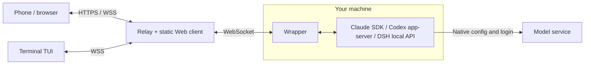

# cc-remote

**Control Claude Code, Codex and DSH on your machine from a phone or browser.**

Self-hosted · Multiple sessions and devices · Live tool activity · Code / Work · Web / PWA / TUI

**Product version: v5.3.7** · Wire protocol v85

[中文](README.md) · [Release install (recommended)](#install-and-upgrade) · [Engine comparison](#engines-and-features) · [Try from source](#quick-start) ·
[Interface tour](#interface-tour) · [Terminal workspace](#terminal-workspace) · [Documentation](#documentation) · [Changelog](CHANGELOG.md)

cc-remote brings your local agent's sessions, tool activity, files and controls to
remote clients. Start a task on your computer, check progress from your phone,
answer a question or steer the task, then return to the same conversation.
Model authentication, provider configuration and tool execution remain with the
local engine. cc-remote does not proxy model APIs.

**We recommend the latest stable Release for regular use.** Follow the
[Release installation guide](docs/installation_en.md#release-install) for your first setup,
then run `cc-remote update` from an independent terminal or SSH connection to upgrade
to the latest stable version. Installation and updates use prebuilt artifacts;
you do not need to clone the repository, run CI or build the frontend.

This README describes the current source tree. For a published package, read the
documentation at its tag: the same product version does not guarantee the same
features or wire protocol across different commits.


Screenshots were captured from cc-remote Desktop through computer use, with the v5.0.0 Web UI
and isolated synthetic data. Projects, paths, devices, conversations, quotas and results are
fictional. See the [interface tour](#interface-tour) for more features.

## What you can do

- **Handle several tasks at once.** Group sessions by directory, search, pin,
  rename and leave them running in the background. Switching views does not stop
  a task. History is paged, with tool details loaded when expanded.
- **Follow the work.** Read streaming replies, engine-provided reasoning
  summaries, plans, tool calls, command output, file changes and approvals.
  Claude, Codex and DSH support steering or queueing while busy. Steering adds
  instructions to the current task without interrupting running tools.
- **Manage longer tasks.** `/goal` exposes each engine's native progress, budget
  and controls. Claude and Codex also offer temporary `/btw` side conversations
  while the main task continues.
- **Read files directly.** File and directory links in messages connect to
  `/open` and the preview panel: source, Markdown, images, HTML, PDF, audio and XLSX.
- **Connect machines and accounts.** Pair, switch and revoke devices in Device
  Center. Built-in Claude/Codex multi-account support lets you use OAuth accounts
  and third-party API gateway accounts in one interface.
- **Customize appearance.** More settings → Appearance adjusts accent, background,
  text and fonts. Each engine’s light/dark styles are saved separately in the
  current browser; reset restores only the visible style.
- **Work from a phone.** Compact engine menus, light/dark themes, image zoom, PWA
  installation and optional background notifications. Notifications default to
  generic status; showing a session name requires an explicit opt-in.
- **Continue in a terminal.** The full-screen TUI supports Claude/Codex Code and
  Work, sharing Web sessions, running state and queues. Use Vim-style controls,
  a searchable session tree, tabs and tool details. [Install and run](#terminal-workspace).

### Code and Work

**Code** operates in your chosen project directory for development, debugging and
other agent tasks. It supports Claude, Codex and the optional DSH integration.

**Work** is a separate Claude/Codex workspace for documents, spreadsheets,
presentations and research. It includes private projects, file/link/note sources,
work templates, artifacts, and one-shot, daily or weekly schedules. Each work
item has its own directory; add material through attachments or the project
library. Work sessions and material are separate from Code.

## Engines and features

v5.0.0 adds optional **DSH 0.2.1-rc.2** integration, using the current Code chat UI
and a separate white/blue default palette. It supports native commands, Skills,
questions and approvals, steering/queueing, Goals, subagents, jobs and artifact
previews. See [DSH integration](docs/dsh-integration.md) for pairing, verification
and capability boundaries. DSH retains model authentication; connecting does
not automatically upgrade or migrate existing DSH data.

This table describes **capabilities connected in cc-remote**. Models, permissions
and extensions still depend on the native installation on the selected device.

| Capability | Claude Code | Codex | DSH |
|---|---|---|---|
| Connection | Daily Claude CLI + Agent SDK | Official app-server, shared daemon | Native local API, separate pairing |
| Code / Work | Both | Both | Code only |
| Full-screen terminal TUI | Supported | Supported | Not yet supported |
| Models and reasoning | Native models and supported levels | Native models, reasoning effort, service tier | Native models, reasoning levels, permissions and presets |
| Plan | Native Plan mode | Native Plan collaboration mode | Native command catalog; depends on the preset |
| Goal | Completion condition, check count, latest feedback, token usage and elapsed time | Objective, optional token budget, pause/resume, complete and clear | Objective, round limit, pause/resume, complete and clear |
| `/btw` side conversation | Supported | Supported | Disabled pending native session deletion |
| Archive and delete | Archive, restore, delete | Archive, restore, delete | Archive and restore; no deletion |
| Fork sessions | Supported | Supported, including a separate worktree | Persistent native fork; no worktree |
| File changes | Project Git diff and per-turn records | Project Git diff and per-turn records | Project Git diff and native per-turn snapshots; released, unsaved snapshots cannot be recovered |
| Engine-specific tools | Hook management, native questions and tool approvals | Review, idle-session directory migration, status and account limits | Subagents, jobs, workflows, trajectory, terminals and schedules |
| Extensions | Skills, plugins, MCP, Hooks and supported management | Skills, plugins, Apps, MCP; read-only Hooks | Skills, local plugins and bundles; no marketplace yet |

### Goal budgets are separate from context capacity

`/goal` opens the current engine's goal dialog, with controls matching native capabilities:

- **Claude** uses a completion condition and native check feedback. It shows
  usage and elapsed time, without a Codex-style token-budget input.
- **Codex** can set a cumulative token budget for a goal or leave it unlimited.
  That budget does not increase the context window.
- **DSH** uses a native round limit and automatic continuation state, with pause, resume, complete and clear controls. This is not a token budget.

### DSH session tools

Open **More → DSH session tools** for subagents, background jobs, workflows, trajectory,
outputs, automation, runtime settings, plugins, presets, terminals and diagnostics.

- **Modes:** choose Standard, PTC, Minimal or Cordis when starting a session. Available presets come from local DSH; the current mode appears beside `Code`.
- **Agents and jobs:** inspect native activity and continue, steer or stop controllable agents. Older sessions may first need migration in the official client.
- **Terminals:** use the device's interactive shell with scrollback, Ctrl+C, reconnect and close controls. Hiding the panel keeps the terminal alive; commands are executed directly by the user.
- **Automation:** choose a target session, recurrence and time in a form, or create a schedule through conversation. Delivery records confirm delivery; inspect the target session for the task result.
- **Settings and extensions:** save settings according to native application scopes and manage local plugins/bundles. Changes requiring restart remain pending until the next launch.

**Current boundaries:** DSH supports Code only. Suitable session deletion and marketplace APIs
are unavailable. Side-chat menus, shortcuts and `/btw` are disabled pending upstream support.
Archiving hides sessions without reclaiming native history. DSH supports project Git diffs
and archived native per-turn file snapshots. Released snapshots that were not saved are
shown as unavailable; current Git state never substitutes for historical changes.

## Common operations

Type `/` in the composer to see commands available for the current engine.

| Entry | Purpose |
|---|---|
| `/model` | Choose a model and reasoning level |
| `/goal` | Open the current engine's goal dialog |
| `/plan` | Claude/Codex exit with `/normal`; DSH follows native commands, using `/plan off` when available |
| `/btw [question]` | Start a temporary side conversation based on the current Claude/Codex session |
| `/open [path]` | Browse directories; also available from More → Session files |
| `/preview <path>` | Open a file preview |
| `/diff` | Inspect current project Git changes |
| `/rewind` | Claude Code: choose an earlier message to restore conversation, files, or both |
| `/context` | Inspect context usage; the small composer gauge opens it too |
| `/autocompact` | Claude/Codex session context settings, with the semantics below |
| `/status` | Codex thread, configuration, usage and account limits |
| `/skills` | Inspect engine Skills; Claude/Codex also have `/extensions` and related catalogs |

On desktop, **Enter sends and Shift+Enter inserts a newline** by default. Assistant
question dialogs use the same keys; **Esc** dismisses the dialog while leaving
the question unanswered. Confirming an IME composition does not submit it.

Claude Code also offers **Rewind** beside historical user messages. Confirm a message
to restore the state before it was sent; running and queued tasks must finish first.
File restore covers only files recorded by Claude's native checkpoints and may
overwrite later manual edits to those files. Without a checkpoint, only conversation
restore is available. Conversation changes sync to other clients. The original prompt
returns to the requesting composer's empty draft and is never sent automatically.
Unsupported CLI versions or connections report that rewind is unavailable. See
[Claude rewind](docs/claude-rewind.md) for implementation and validation details.

Side conversations, file previews, diffs, session files, agent details and remote
previews have a header button to expand into a centered view or dock on the right.

Native Codex agents and MCP background tasks appear above the composer in the
background task control. Click an agent to inspect its activity. Refreshing or
reconnecting restores ongoing work; finishing the main response does not clear
an agent that is still running.

**More → Artifacts** lists uploads and delivered file links for the current session;
side chats have their own Artifacts entry. Discovery also recognizes
code-formatted local paths and filenames in a list or
table introduced by an explicit directory. It does not crawl directories or
automatically treat tool-read files as deliverables.
Tables may omit or mix leading/trailing pipes and use an explicitly labeled
filename/path column; code-formatted source
filenames or identifiers in description columns are not treated as deliverables.
Opening a file replaces the list with
its preview; Back returns to the list. New uploads have durable private copies,
while delivered files reference their original paths. Older sessions are indexed
one history page at a time; previously deleted temporary uploads cannot be recovered.
Private attachment copies are capped at 256 MiB / 512 files per session and
2 GiB / 4096 files per Wrapper state directory, with 256 MiB of disk space reserved.
At a limit, new copies are skipped and logged; existing attachments are preserved
and sending continues. Later previews depend on files still available in native history.
Deleting a session releases its copies; archiving does not. Delivered originals
are never counted against these limits or deleted by this cleanup.
The existing session file browser continues to browse directories independently.

In Claude/Codex, **⌘/Ctrl+Shift+K** opens or collapses side chat. **⌘/Ctrl+Shift+E** only toggles
centered side chat, above any open or expanded file preview. Files keep their
own expand/dock buttons and retain their layout and unsaved edits underneath.
Pressing it again, clicking outside, or pressing **Esc** restores the previous
state: hidden if opened directly, docked if expanded from the right panel.
Layout changes preserve conversations, drafts, file edits and preview pages,
and leave running tasks active.
Use the paperclip to add attachments; images, files and pasted-text
cards appear above the input of the corresponding chat.

### Context and automatic compaction

In **Codex Code**, `/autocompact 300k` sets the session's maximum usable context
to **300,000 tokens**. Automatic compaction targets roughly **95%** of that
capacity, subject to the effective threshold shown in the popover and Codex's
native limits. The gauge uses native compaction estimates rather than treating
last-request usage as the compaction trigger. A temporary read failure keeps the
last valid reading for the same session and model, without repeated loading notices.

A setting saved while busy may remain pending until the thread is idle and other
clients release it. `/autocompact default` restores native defaults. This Codex
override does not apply to Work or temporary side conversations. Restore defaults
before switching to a model with a smaller context window.

**Claude** keeps native automatic compaction by default, with an explicit automatic
or `100K–1M` session-window choice available. Lowering it first verifies a native
compact boundary. Reading context creates no model turn.

## Files and previews

Code's `/open` starts in the session directory and supports parent directories,
absolute paths and `~`. Regular files readable by the Wrapper's OS user can be
viewed even when another user owns them. External files are read-only by default;
Work stays within its own workspace. Directory reads are paged and non-recursive.
Symlinks and special files are not opened.

| File | Preview and limits |
|---|---|
| Source, text, Markdown | Line navigation and rendered previews; Markdown successfully written by this session supports conflict-safe editing |
| Images, PDF | Direct previews; images support a lightbox and zoom |
| Audio | Playback, seeking, speed and download; up to 8 MiB, with codec support determined by the browser |
| XLSX | Worksheet tabs and saved cell values on macOS/Linux without Office. No formula evaluation or external-link execution. Size, row/column and total-cell bounds apply; truncation is indicated and the original can be downloaded |
| DOC/DOCX/ODT/RTF, XLS/ODS, PPT/PPTX/ODP | Temporary PDF conversion with LibreOffice + bubblewrap on a Linux Wrapper; unavailable without that conversion environment |
| HTML | Sanitized, scriptless file preview; use [Remote Viewer](docs/remote-viewer.md) for interactive multi-file static pages |

Parsing/conversion happens on the Wrapper host or in the browser. Files return to
the requester through an authenticated connection. The relay does not persist
originals or previews. Viewer defaults to the main site origin without another
preview domain; it does not proxy arbitrary private-network services.

## Architecture



Wrapper connects outbound to Relay; the device needs no public inbound port.
Relay handles the control connection while the native engine connects directly
to its model service. The two connections are configured independently.

<a id="quick-start-local-one-machine-5-min"></a>

## Quick start

For regular use, start with [Release installation and one-command updates](#install-and-upgrade).
The steps below are for source development and local evaluation: run Relay, Wrapper
and the web client on the agent's machine. Source
development/builds use **Python 3.13 and Node 24**, matching CI and [`.nvmrc`](.nvmrc).

Prepare at least one working engine:

- **Claude:** daily Claude Code `>= 2.1.263`, normally at `~/.local/bin/claude`.
  Wrapper launches that CLI; the Python Agent SDK is pinned to `0.2.174`.
- **Codex:** an authenticated official CLI. Shared control requires both
  `codex app-server daemon --help` and `codex app-server proxy --help`.

- **DSH (optional):** Node 24 and `@deepseek-ai/dsh@0.2.1-rc.2`. Follow [DSH integration](docs/dsh-integration.md)
  to start the local API, load the metadata plugin and pair. Wrapper installation does not install or upgrade DSH automatically.

### 1. Install dependencies and build

```bash
git clone https://github.com/muggle-stack/cc-remote.git
cd cc-remote
# For development-branch features, check out that branch before installing/building.
python3.13 -m venv .venv
.venv/bin/python -m pip install --require-hashes --only-binary=:all: -r requirements.lock
# Use Node 24 for the following commands.
npm --prefix web ci
npm --prefix web run build
```

### 2. Configure local access

Copy the template only for a first setup. Edit an existing `.env` in place to
preserve its secrets.

```bash
install -m 600 .env.example .env
openssl rand -hex 32   # Generate SESSION_SECRET.
openssl rand -hex 32   # Generate a separate WRAPPER_TOKEN.
```

Set actual values in `.env`; angle-bracket values below are placeholders:

```ini
LOGIN_PASSWORD=<strong web login password>
SESSION_SECRET=<first random value>
WRAPPER_TOKEN=<second random value>
PUBLIC_ORIGIN=http://127.0.0.1:8765
RELAY_URL=ws://127.0.0.1:8765/ws
WEB_STATIC_DIR=web/dist
CC_CWD=/absolute/path/to/project
CLAUDE_BIN=
```

An empty `CLAUDE_BIN` selects the default path; an override must be an absolute
path.
The local `.env` is for development; production credential storage is covered in
[Installation](docs/installation_en.md).

### 3. Start

Open two terminals in the repository directory and run separately:

```bash
# Terminal 1
.venv/bin/python -m cc_remote.relay
```

```bash
# Terminal 2
.venv/bin/python -m cc_remote.wrapper
```

Open [http://127.0.0.1:8765](http://127.0.0.1:8765) and sign in with the configured
password. Check that the device is online, then select an engine and session.
This address is local to the computer. For phone access, use the public deployment
below or configure a restricted LAN/Tailscale entry point.

<a id="one-command-github-release-install-recommended-for-production"></a>
<a id="production-deploy-public-vps-relay--wrapper-on-your-machine"></a>

## Install and upgrade

**For your first deployment, use the [latest stable GitHub Release](https://github.com/muggle-stack/cc-remote/releases/latest).**
Follow the [Release installation guide](docs/installation_en.md#release-install) to install
Relay on your VPS and Wrapper on each device. Installers register the `cc-remote`
management command automatically. Subsequent updates need no manual package download;
run this from an independent terminal or SSH connection:

```bash
cc-remote update --check   # Check versions only
cc-remote update           # Install the latest stable Release; no latest argument needed
```

Each device checks its paired VPS first, updating Relay + Web when necessary.
An already-current compatible Relay is skipped. Use
`cc-remote update --relay-ssh operator@relay-host` to bind an existing SSH admin
entry for the first remote server upgrade. Update other devices individually.
Installation uses prebuilt artifacts; it does not run CI, pytest or a frontend
build on users' machines. Protocol upgrades require coordinated Relay, Web and Wrapper
activation; follow the [deployment procedure](deploy/README.md). The Electron application
is updated separately; see [Desktop compatibility](docs/desktop.md).

v4.0.10 adds automatic retention: after acceptance, keep the active
version, one complete previous rollback set and all live runtime dependencies;
remove proven older generations. Linux Wrappers can also use an existing Supervisor
with the same updater, preserving their root, account and HOME; see
[Supervisor installation/adoption](docs/installation_en.md#linux-supervisor-installation-and-adoption).
These features ship in **v4.0.10**, including when an older updater downloads the
new installer. Unresolved dependencies defer cleanup and preserve older files.
See [subsequent updates](docs/installation_en.md#subsequent-updates) for command
locations, older installations, roles and coordinated protocol upgrades.

| Scenario | Guide |
|---|---|
| Regular use and production deployments (recommended) | [Release packages](docs/installation_en.md#release-install): choose the latest stable version, then use `cc-remote update`; Linux Relay and macOS/glibc Linux Wrappers have x86_64 / arm64 packages |
| Development, debugging or testing unreleased features | [Source deployment](docs/installation_en.md#source-install): use one tested snapshot |
| Containers or an existing reverse proxy | [Deployment reference](deploy/README.md#container-deploy-docker-and-the-nginx-alternative) |

The production Relay keeps immutable versions under `/opt/cc-remote/releases/`
and switches `/opt/cc-remote/current` atomically. Preserve external configuration
and private-state snapshots before upgrading. Relay, Web and every Wrapper must
come from one source snapshot or coordinated artifact set. Mismatched protocols
cannot connect.

[deploy/README.md](deploy/README.md) owns the release procedure, rollback and
acceptance checks. AI-assisted deployment uses the repository's
[deployment skill](.agents/skills/cc-remote-deploy/SKILL.md). Verify that each Codex
account's daily CLI and Wrapper use the same official daemon. Attaching an
installed Codex App is a separate optional step, with distinct
[macOS](docs/codex-desktop-launcher.md) and [Linux](docs/codex-desktop-linux.md)
procedures, independent of core deployment success.

### Web, PWA and Desktop

Web/PWA are the released graphical clients, sharing one UI across all three engines.
The existing macOS Desktop is an experimental Electron shell; v5.3.7 does not ship a new
Desktop installer. The compatibility repair loads the configured Relay's pages instead of
outdated bundled assets, retaining sign-in and native integrations. `cc-remote update` updates
Relay, Web and Wrapper, not the Electron application. See [Desktop compatibility](docs/desktop.md).

## Configuration and native clients

- **Claude:** sessions owned by native CLI/Desktop/Agent View are mirrored
  read-only until the user explicitly takes over. The official `claude` command
  remains unchanged.
- **Codex Code:** coordinates through the official shared daemon. A private stdio
  fallback lacks the same bidirectional sharing and does not satisfy shared-control
  deployment acceptance. Work uses private processes.
- **DSH:** keeps its own model authentication, plugins and session storage, with a
  separate local API pairing file. It does not share Claude/Codex account directories;
  older session formats are migrated in the official client.

See [Configuration, accounts and data](docs/configuration_en.md) for account
directories, proxies, device policy, notifications and environment variables.
Claude/Codex can mix official OAuth accounts with third-party API gateway accounts
supported by the native CLI. First sign in or configure API access in each account's
native directory, then [register its profile](docs/configuration_en.md#multiple-accounts)
to select and use it in cc-remote. Configuration, authentication, sessions and
extensions remain separate for each account; credentials stay on the local machine
and are never sent to the web client or relay. Without registered profiles,
cc-remote continues using the existing default account.

<a id="security-please-read"></a>

## Security and data

**Treat anyone who can sign in and use Code as holding remote agent/shell access
to the Wrapper machine.** Code defaults are permissive. Work's private-directory
policy is not a replacement for separate OS users, containers or virtual machines.

- Use HTTPS/WSS publicly and keep credentials outside source/release directories.
  Linux production services use root-only environment files; the macOS installer
  uses the current user's private configuration.
- Web login uses an HttpOnly, SameSite=Strict cookie with exact WebSocket Origin
  checks. Wrapper credentials travel in request headers; device authorization is
  scoped by `machine_id`.
- Session sources and Work data remain on the device; browsers cache history
  projections. Relay forwards conversation traffic without persisting chats or
  artifacts. Control metadata such as device registrations and Push subscriptions
  is persisted.
- Browsing history and reading context do not request model inference. Messages,
  side conversations and native goal continuation still use the model account's
  allowance or billing.

## Documentation

| Guide | Contents |
|---|---|
| [Installation and upgrades](docs/installation_en.md) | Release packages, source, pairing, network access |
| [Configuration, accounts and data](docs/configuration_en.md) | Profiles, environment variables, authentication, queues and history |
| [Deployment procedure](deploy/README.md) | Immutable releases, rollback, shared control and acceptance |
| [DSH integration](docs/dsh-integration.md) | Pairing, modes, native controls and capability boundaries |
| [Desktop compatibility](docs/desktop.md) | Legacy Electron UI recovery, sign-in preservation and rollback |
| [Remote Viewer](docs/remote-viewer.md) | Interactive static pages, Bridge/Isolated modes |
| Codex App: [macOS](docs/codex-desktop-launcher.md) / [Linux](docs/codex-desktop-linux.md) | Optional App, daily CLI and Wrapper on one daemon |
| [Codex App tools](docs/codex-app-tools.md) | Optional App-control MCP |
| [Generic async task MCP](docs/async-tasks.md) | Run scripts/external agents in the background and return results to the originating Codex thread |
| [Cross-session messaging MCP](docs/session-messages.md) | Unified Claude/Codex delivery alongside native Codex App messages, source labels and receipts |
| [Releasing a session to a local process](docs/local-control.md) | A local program asks the Wrapper to let go of an idle Claude session it keeps for a viewer |
| [Timed messages](docs/timed-messages.md) | Scheduled queue receipts, message tags and countdown UI |
| [Terminal workspace](docs/tui.md) | TUI setup, connections, Vim controls, session tree, previews and terminal limits |
| [Changelog](CHANGELOG.md) | Version changes and migrations |

<a id="terminal-workspace"></a>

## Terminal workspace (preview)

The built-in Python/Textual full-screen TUI supports **Claude/Codex Code and
Work** through the same Relay and Wrapper as Web. Sessions, running state and
queues share the control link. Closing the TUI leaves running tasks and accepted
queued messages intact; native clients' session ownership rules still apply.

After installing the source dependencies above, add the optional terminal packages:

```bash
.venv/bin/python -m pip install -r requirements-tui.txt
# Offline preview; no server connection or model calls.
./scripts/cc-remote-tui --demo
# Connect to your Relay; replace the example domain and enter the password when prompted.
./scripts/cc-remote-tui --engine codex --url wss://cc.example.com/ws
```

Use `--engine claude` for Claude or `--space work` for Work. Append a session ID
to open it directly, or use `--machine <id>` to select an authorized device.
The TUI, Relay and Wrapper must use the same source/protocol version. See the
[terminal workspace guide](docs/tui.md) for authentication, local automatic
login and a launcher that works from any directory.

| Action | Default keys |
|---|---|
| Session directory tree and search | `Space e` in Normal mode, then `/` to search |
| Switch open sessions | `H` / `L` in Normal mode; `Space ,` searches tabs |
| Focus transcript / draft | `Ctrl+k` / `Ctrl+j` |
| Type and send | `i` enters Insert; `Esc` returns to Normal; Normal `Enter` sends |
| Queue / stop the current turn | `Ctrl+e` / `Ctrl+x` |
| Current shortcut help | `Space h` |

Vim selection, copy and quote, on-demand thinking/tool/process details, elapsed
time, Goal / Plan, usage and queue editing are available. Active status text
sweeps from left to right and stops on completion or interruption; set
`TEXTUAL_ANIMATIONS=none` to disable animation. Markdown previews work in the
terminal; images depend on its graphics protocol, and other content offers a
Web handoff. Use `--line-mode` for the original line-oriented client.

## Development

Use Node 24 for the web client and the repository's Python dependency locks.
Common tests that do not call a live model:

```bash
.venv/bin/python -m pip install -r requirements-dev.txt
.venv/bin/python -m pytest
npm --prefix web run test:reliability
npm --prefix web run lint
npm --prefix web run build
```

Local and CI Python tests default to two parallel workers, configured in
`pytest.ini`. Pytest reports the slowest 20 phases, and CI retains a JUnit
timing report. Use `.venv/bin/python -m pytest -n 0` for serial debugging.
During development, run small affected modules without worker startup overhead,
for example `.venv/bin/python -m pytest -n 0 tests/test_dsh_upload_recovery.py`.

Maintainers run the complete local gate before submitting a PR; see
[AGENTS.md](AGENTS.md#commit-and-pr-gate). Other contributors may submit a PR
with a description of the checks performed and any validation gaps. PRs and
pushes to `master` automatically run the **Web build and pytest**; releases
reuse these checks. Playwright is not part of CI or the required local PR gate.
Its tests remain available for diagnostics when requested. For PR acceptance,
maintainers check out the requested revision and verify the changed behavior
in the running application.
[Live probes](scripts/live/) run separately; live model probes may spend tokens
and are not default unit tests.
Use `npm --prefix web run dev` for the UI dev server, or the built Relay-served
web client for same-origin integration.

## FAQ

- **Why can I list a file but not preview it?** Previews also require a regular
  file, a supported format and size, and OS read permission. XLSX needs no Office;
  other Office formats need the Linux conversion sandbox.
- **Does restarting Wrapper lose history?** Persisted history remains. Live-tail
  replay and ordinary pending messages are bounded in-memory state and are not
  guaranteed across a Wrapper restart. Work schedules have separate durable records.
- **What happens when Relay restarts or moves?** Browsers reconnect and sign in
  again; device-local sessions remain. Moving Relay also requires migrating or
  recreating device authorization, Push and other control configuration, not just
  changing its address.
- **Does phone access need an inbound port on my computer?** No. Wrapper connects
  outbound; the public entry point is on the Relay host.

## Interface tour

Real Desktop screenshots with isolated demo data. Click an image for full resolution.
These illustrate the interface, not live model benchmark results. See the [engine comparison](#engines-and-features) for capability boundaries.

<details>
<summary>Claude: sessions and collapsible activity</summary>


</details>

<details>
<summary>DSH: mode badge, native Goal and shared chat UI</summary>


</details>

<details>
<summary>DSH: new-session modes</summary>


</details>

<details>
<summary>DSH: session tool categories</summary>


</details>

<details>
<summary>Subagents: inspect activity and continue collaboration</summary>


</details>

<details>
<summary>Interactive terminal: interrupt, reconnect and close</summary>


</details>

<details>
<summary>Automation: target session, recurrence and time</summary>


</details>

<details>
<summary>DSH Goal: round budget and continuation</summary>


</details>

<details>
<summary>Artifacts: files delivered in this session</summary>


</details>

<details>
<summary>Document sidebar: Markdown, tables and Mermaid</summary>


</details>

<details>
<summary>Centered preview: focused reading and source view</summary>


</details>

<details>
<summary>Appearance: independent light/dark styles per engine</summary>


</details>

## License

MIT — see [LICENSE](LICENSE).
