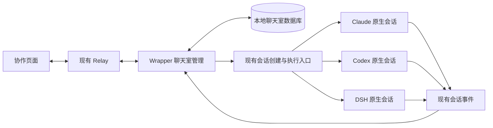
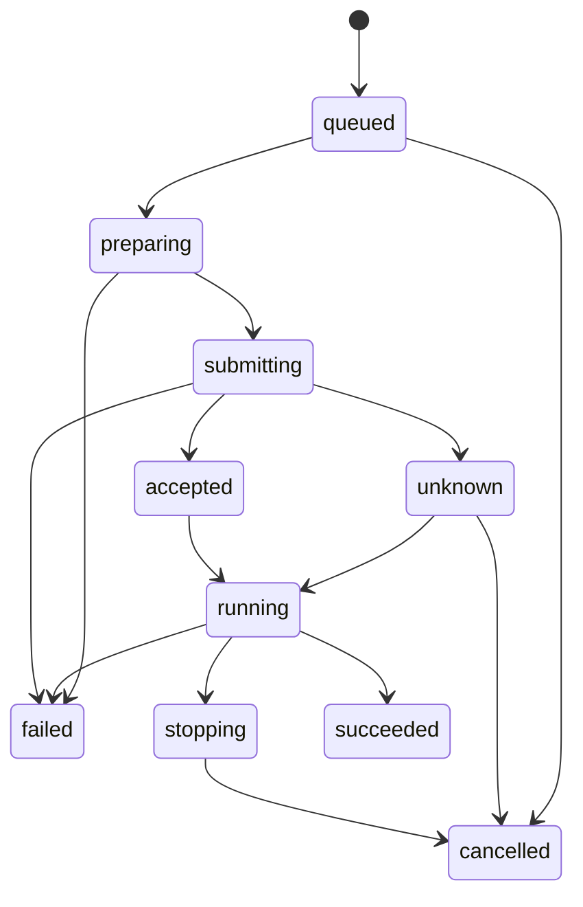

# 协作聊天室适配方案

本文记录已对齐的交互、后端适配方式与验收条件。第 11 节说明当前实现范围与验证情况。

## 1. 功能与接入方式

用户从现有 Harness 菜单进入「协作」，创建聊天室并添加 Claude、Codex、DSH
参与者。每位参与者选择自己的账号与工作目录，其他配置可以沿用原生默认值。
用户通过默认回复者或输入 `@` 选择本次执行的参与者。

执行与配置通过 cc-remote 已接入的原生接口完成。Claude 使用现有 Agent SDK
和会话服务，Codex 使用现有官方 app-server，DSH 使用现有本机控制服务。
代码变更范围集中在 cc-remote 的聊天室数据、调度、事件投影、协议与 Web 界面。

每个聊天室参与者拥有一个独立的原生会话。用户能够在对应 Harness、账号和
目录下找到该会话，查看详细过程并使用现有控制功能。聊天室共享用户问题和
参与者公开回复，原生会话承担完整的工作历史。



## 2. 交互与执行语义

| 用户操作 | cc-remote 的处理 | 原生操作 |
| --- | --- | --- |
| 创建聊天室 | 保存房间、参与者与默认回复者 | 首次执行时创建相应会话 |
| 添加参与者 | 分配参与者 ID，保存 Harness、账号和配置 | 首次执行时创建相应会话 |
| 设置成员配置 | 创建或加入时保存显式覆盖项，读取真实可选能力 | 创建时应用，后续通过原生会话调整 |
| 发送普通消息 | 保存消息并解析默认回复者，按目标会话状态选择投递方式 | 空闲时发送，运行中引导 |
| 输入 `@` 点名 | 将选择结果保存为参与者 ID，补充共享上下文 | 向被选择的会话发送或引导 |
| 点名多位参与者 | 为每位参与者建立一条执行记录 | 各原生会话独立执行 |
| 查看进度 | 只读加载该参与者的原生历史与实时过程 | 复用现有历史与详情读取 |
| 查看原生会话 | 使用完整会话绑定导航 | 进入现有原生会话页面 |
| 停止某位参与者 | 取消其待派发记录，向活动回合发送停止请求 | 复用现有 interrupt/cancel 与终止确认 |
| 移除参与者 | 保存退出状态和历史绑定，结束后续自动派发 | 活动执行继续由原生会话管理 |

### 已对齐的界面契约

- 成员管理放在右上角成员入口，支持新增参与者和选择默认回复者。
- 输入框保留附件与发送按钮，输入 `@` 打开点名选择，底部显示默认回复者。
- 工作态按照「静态 Harness 图标、账号名称、独立动态火花、流光词」排列。
  Claude、Codex、DSH 使用现有 `EngineWorking` 与 `WorkingWord` 的图形和配色。
- 消息保留「查看进度」和「查看原生会话」入口。
- 手机端使用折叠侧栏和紧凑顶栏，成员配置转为适合触摸的弹窗或抽屉，输入区适配软键盘。

### 本方案采用的执行默认值

- 一个聊天室归属于一台设备，该设备的 Wrapper 保存数据并执行调度。
- 一个参与者持续复用一个原生会话，同一账号可创建多个独立参与者。
- 同一参与者按顺序接收输入，空闲时发起新回合，运行中追加原生引导。不同参与者
  可以并行。工作目录、文件权限和可写范围由所选 Harness 的现有配置决定。
- 参与者的公开回复在下次点名时进入其他参与者的输入上下文。新的执行由用户消息触发。
- 第一版将该执行的最终公开回复作为共享总结，保存来源与修订信息。

## 3. 数据归属与持久化

Wrapper 的私有状态目录新增 `collaboration.sqlite3`，采用 SQLite 事务和 WAL。
房间与原生会话分别保存自己的数据，关联关系由聊天室数据库持有。

| 数据 | 关键字段 | 用途 |
| --- | --- | --- |
| 房间 | `room_id`、设备、所有者、名称、默认参与者、修订号、归档时间 | 房间列表、归属和设置 |
| 参与者 | `member_id`、`room_id`、显示名称、Harness、账号引用、配置覆盖、状态 | 成员管理和精确点名 |
| 会话绑定 | `member_id`、绑定代次、设备、Harness、账号引用与版本、路由 SID、原生 SID、有效工作目录 | 跨页面导航与重启恢复 |
| 房间消息 | `message_id`、房间序号、作者、目标成员、正文、附件引用、来源、回应的问题集合 | 用户消息和公开回复的分页历史 |
| 执行记录 | `run_id`、问题 ID、参与者 ID、配置版本、上下文范围、投递方式、状态、原生回合身份 | 派发、幂等、终止和结果归属 |
| 投递记录 | 投递尝试、原生请求身份、接收与消费证据、上下文范围、结果修订号 | 发送或引导的核实与补偿 |

账号字段保存现有 profile 或 DSH 连接的引用。配置解析继续由已有账号与原生能力
目录完成。房间记录使用 Relay 认证的所有者与设备授权，跨标签页和手机使用同一
登录身份访问。

会话绑定固定当时的账号身份与配置版本，账号重映射时按现有拓扑迁移规则复核。
历史执行使用其原绑定，当前成员的配置调整通过新的版本保存。

房间消息的稳定序号负责排序，房间修订号负责并发修改校验。客户端时钟仅用于展示。
创建、发送、修改成员和停止操作都携带稳定请求 ID，数据库事务保存对应操作结果。
同一请求 ID 重试时返回已有结果，载荷发生变化时返回明确冲突。

归档保留房间历史、参与者绑定和已接受执行的结果。原生会话的重命名、归档与删除
继续通过已有原生控制操作完成，聊天室根据读取结果更新链接状态。

## 4. 配置与原生会话映射

### 可选配置

成员保存模型、思考强度、权限、工作目录、速度等显式选择。留空项使用缺省值，
在创建原生会话时通过已有逻辑解析。会话绑定保存最终目录和原生反馈的有效配置，
后续恢复使用这份绑定。

配置窗口按 Harness、账号和预期目录读取真实能力。窗口的请求与响应带有选择
版本，账号或目录变化后，旧响应只更新对应缓存。各 Harness 的可选项由原生目录
提供，界面按实际能力显示。

| Harness | 可复用能力 | 适配点 |
| --- | --- | --- |
| Claude | profile、目录与模型默认值、effort、permission、原生会话服务 | 会话级参数应用，创建时的焦点与默认值保存行为 |
| Codex | profile、官方 app-server、模型目录、effort、权限配置、service tier | 会话级参数应用，准确关联 thread 与 turn |
| DSH | 当前连接、模型目录、permission preset、agent preset、effort | 以当前真实连接作为可选实例，准确关联 session 与执行 |

当前 cc-remote 的 DSH 接入为单连接。初始可选范围来自这份已配置连接，同一连接
可以创建多个参与者和独立会话。多个 DSH 账号的映射需要依据实际可用的原生账号
或控制连接能力补充，连接身份必须进入模型目录、路由、历史与执行记录。

### 创建与恢复

成员首次被点名后，通过已有会话创建逻辑创建真实会话。开始接受输入前，完成
账号、目录和成员配置的校验。原生返回真实 SID 时，更新绑定和执行记录中的临时 SID。

当前 `WrapperMachine._handle_new_session` 包含设置 `focused_sid`、发布
`SessionFocus` 和保存部分 Claude 默认值的交互行为。实现时从该路径提取范围有限
的会话创建入口，明确支持后台创建和会话级覆盖参数。既有新会话入口继续调用
原来的前台创建与保存流程。

用户点击查看链接时，前端使用设备、Harness、账号、路由 SID 和原生 SID 进行导航。
恢复从持久绑定出发，采用现有会话归属检查和生命周期规则。

创建或添加参与者时可调整创建配置。绑定后修改模型、强度或权限，进入原生会话
使用已有控制。需要更换账号时可添加新的参与者，旧参与者的绑定和历史继续保留。

## 5. 一次消息的处理流程

1. Web 提交正文、附件和目标 `member_id`。普通正文中的 `@` 字符由点名选择结果
   解释，实际路由依据结构化目标列表。
2. Wrapper 验证房间归属、设备授权、成员状态、配置修订和附件有效性。
3. 一个事务保存用户消息，以及每个目标成员对应的执行记录。提交成功后返回接收回执。
4. 调度器按参与者顺序领取待投递记录，准备或恢复该参与者的原生会话。
5. 构建本次共享上下文并记录覆盖范围，读取原生活动状态。空闲时通过已有 Query
   路径提交，运行中通过已有 Steer 路径追加输入。
6. 原生接收证据写入执行记录，工作状态随真实生命周期推进。
7. 原生公开输出与本次执行关联。公开回复发布和执行状态更新分别保存可恢复的来源信息。
8. 页面切换或断线后，客户端通过房间快照和序号补齐记录。

原生消息在发送阶段可能经历临时 ID、客户端消息 ID 和原生回合 ID。执行记录保留
这些身份的精确对应，覆盖引导输入、排队输入与后台续接，结果按已验证归属发布。

附件沿用现有校验与原生上传流程。房间保留附件引用，每个目标执行分别记录准备与
接收情况，引用按仍需使用的执行计数回收。排队和重启恢复所需文件进入私有状态
保护范围。

### 空闲发送与运行中引导

一次点名表示用户向目标参与者提供新输入。Wrapper 在实际投递时，依据目标原生
会话的状态与可写能力，选择对应的现有入口。

| 目标状态 | 投递行为 | 回执与界面状态 |
| --- | --- | --- |
| 尚未创建会话 | 创建绑定后发送第一条输入 | 准备中，随后进入已接收或执行状态 |
| 空闲且可写 | 调用现有 Query 路径 | 已发送，按原生事件显示进度 |
| 正在执行且可引导 | 调用现有 Steer 路径 | 引导已提交，接收或消费确认后更新归属 |
| 切换、恢复、终止收尾或暂时无法接收 | 保存待投递记录并展示具体原因 | 等待可投递状态，后续重新核对状态 |
| 提交结果未知 | 按原请求身份核实原生接收情况 | 结果待确认 |

| Harness | 现有发送入口 | 现有引导入口 |
| --- | --- | --- |
| Claude | 当前 Query 与会话服务路径 | `SdkHandle.steer`，经流式输入使用 `priority=next` |
| Codex | 当前 Query 与 app-server 回合创建路径 | `CodexHandle.steer`，使用 `turn/steer` 并关联准确活动回合 |
| DSH | `DshRuntime.query`，使用 `session/prompt` | `DshRuntime.handle_steer`，使用 `session/prompt` 的 `mode=steer` |

引导的接收与生效时点遵循对应原生行为。Claude 的接收回执与后续原生用户消息
回显分别处理，Codex 使用活动回合匹配，DSH 使用原生请求身份。停止操作拥有
独立的用户入口和明确的 interrupt/cancel 请求。

目标状态可能在用户点击发送后改变。明确拒绝且确认本次输入尚未接受时，沿用
同一房间消息重新读取状态，创建可追踪的投递尝试，再选择发送或引导。原生接收
证据和结果待确认记录决定后续动作。

### 投递顺序与队列归属

房间的待投递记录由数据库持有，每位参与者的输入按房间顺序提交。投递锁覆盖
状态选择和接收确认，锁的释放依据本次原生调用的回执或已登记的待确认状态。
当前回合持续执行时，后续点名通过原生引导追加到该回合。

每条输入只有一个派发所有者。需要使用已有队列时，记录队列接收回执和所有权
移交，调度器据此继续等待或处理后续输入。原生会话页面的操作与房间投递共同
使用已有会话锁和归属检查。

多条引导可能进入同一个原生回合，共享一次最终回复。执行记录保留每条输入的
接收与消费状态，公开回复关联其实际回应的问题集合。每条原生回复按消息身份
发布一次，每位参与者的活动展示根据最新已确认输入更新。

Claude 的中间 Result、尚待消费的引导和后台续接继续使用当前精确归属机制。
某条输入的完成依据覆盖该输入的原生终止证据。

### 停止与移除

取消待派发记录在数据库完成。停止已提交的执行调用对应原生控制，保留停止中状态，
直到现有执行链路确认终止。Claude 使用既有 interrupt/drain 规则，Codex 与 DSH
使用各自真实终止事件。

成员移除后保留历史身份和在途执行，移除时取消其尚未提交的房间记录。停止在途执行
使用明确的停止操作。这样原生会话中已经接受的工作始终具有可追踪的归属。

## 6. 共享上下文与公开回复

### 参与者如何获得其他人的聊天

cc-remote 在每次发送或引导时，将房间上下文整理进本次原生输入。输入包含以下内容。

- 成员名单、各自的 Harness 与账号显示名称，以及本次输入的目标参与者。
- 当前用户问题及本次选择的附件。
- 房间目标、自己的工作目录与当前执行要求。
- 该问题之前、参与者尚未同步的用户消息和其他参与者已发布的回复。
- 每段共享内容的作者、房间序号、源问题和状态，便于区分建议、结论与用户要求。

成员首次使用的输入包含此前公开讨论，后续发送与引导补充增量。成员名单的变化
也随输入同步。共享上下文作为带来源的讨论资料，当前用户问题单独标明。

例如，用户在房间中点名正在执行的 Codex，实际引导可以包含以下内容。

```text
你正在参与「接口重构讨论」。
房间成员包括 Claude · default、Codex · iris、DSH · default。
本次输入发给 Codex · iris。

新增的公开讨论
- #18，用户要求先检查方案。
- #19，Claude · default 建议拆分消息路由。
- #20，DSH · default 提醒补充历史恢复的测试覆盖。

当前用户给你的引导
结合他们的结论，先补充回归测试。
```

这些内容通过既有 Query 或 Steer 一起交给原生会话。其他成员发布新回复后，
目标参与者在下次收到用户输入时获得更新。

房间展示使用已经保存的原始用户正文，附带的协作上下文属于本次投递载荷。
原生用户消息回显根据请求身份补充接收记录，与原房间消息合并关联。

每条执行在保存用户消息时确定上下文截止位置。并行回答同一个问题的参与者使用
相同截止位置。其他参与者随后发布的结论会进入后续问题的上下文。

共享输入作为一条正常用户消息交给原生 Harness。原生会话保留自己的思考与工具
历史，房间上下文从公开消息投影构建。共享仓库中的文件仍按原生权限可读写。

每次投递保存携带的上下文范围，接收回执用于投递去重，实际消费证据用于确认
上下文已进入对应输入。已接受而待消费的引导继续保留其范围和顺序，取消或失去
消费证据后，后续输入根据已确认记录重新补齐上下文。显式更换会话绑定后重新
建立同步记录。

### 最终回复与执行终止

第一版使用本轮最终公开回复作为共享总结，保留其原生消息身份。处理中的思考、
工具输出和临时 commentary 留在原生过程视图中。公开最终消息结束时发布到房间，
原生消息的后续修订以相同来源身份更新。查看进度展示实时原生事件。

回复内容与执行状态分别投影。模型给出一段回复后，状态继续等待原生执行链路的
真实回合边界。Claude 的中间 Result、后台通知和引导接收，Codex 的终止来源，
以及 DSH 的会话活动，都沿用各自已经建立的判断。

观察器将公开消息和终止来源交给房间投影。数据库写入失败时，房间显示结果同步
待恢复，使用原生消息身份补取。原生消息的既有发送与回放继续独立推进。

### 长讨论

原生会话继续使用自己的上下文管理。房间按参与者同步水位发送增量，并对首次
补充和单次输入做大小校验。历史按页保存与读取。

单条用户消息上限为 64 Ki 字符，单次共享输入上限为 1 MiB UTF-8。超预算在提交
模型前显示明确错误，用户可以让已有参与者整理总结，再开启新聊天。自动归纳摘要
和讨论范围选择器留作后续扩展。

## 7. 状态、事件与恢复

### 执行状态



接收确认、公开输出、用户交互和终止证据驱动状态。权限和用户问题保留独立的原生
待答状态。只读核实依据已有接收记录、会话与回合身份恢复投影，结果未知时向用户
提供查看会话和结束等待入口。

| 中断位置 | 恢复方式 |
| --- | --- |
| 消息已落库，尚未派发 | 从数据库继续领取待执行记录 |
| 原生会话准备中断 | 尚未提交输入可重新准备，已有原生创建回执用于恢复绑定 |
| 原生输入已接收，浏览器回执丢失 | 相同请求返回已有接收记录 |
| 原生输入提交结果未知 | 查询原生接收证据，保留核实状态和原请求身份 |
| 执行中 Wrapper 重启 | 按现有生命周期机制恢复观察，核对活动回合 |
| 回复或终止已产生，房间投影写入中断 | 按精确消息与回合身份补取并去重发布 |
| 浏览器刷新或换手机 | 读取房间快照、消息页和最新状态 |
| 某个成员失败 | 该成员展示失败，其余执行各自继续 |

队列、准备、提交和结果投影都需要覆盖进程退出后的恢复。准备中的本地任务与
尚未确定归属的提交接入现有更新忙碌检查。已经由独立原生服务接管的执行依据
原生归属证明参与更新判定。

数据库加入受管理私有状态的快照、恢复和迁移清单，schema 版本与发布事务一起校验。

## 8. 协议与代码接入

协作视图在 Web 保存自己的导航状态，协议中的 `Engine` 继续描述实际执行的
Harness。现有 `collaboration_mode` 对应 Codex 原生模式，聊天室使用独立消息类型。

新增命令覆盖房间列表、创建与更新、归档、成员管理、读取消息页、提交消息、停止
执行和订阅补齐。执行操作携带房间 ID、稳定请求 ID、预期修订和目标参与者 ID。

新增事件覆盖房间快照、消息变化、成员变化和执行状态。使用独立房间序号，原生
`sid` 用于会话绑定和查看链接。浏览器根据房间序号去重与补齐，Relay 按已认证的
设备、所有者和订阅目标路由。

| 接入位置 | 工作内容 |
| --- | --- |
| `cc_remote/collaboration.py` | 房间数据校验、上下文构建和公开表示 |
| `cc_remote/collaboration_store.py` | SQLite schema、事务、请求回执、历史和执行记录 |
| `cc_remote/wrapper/collaboration.py` | 派发、原生会话绑定、事件观察和恢复 |
| `cc_remote/wrapper/machine.py` | 提取后台创建入口，接入查询、停止和精确事件关联 |
| `cc_remote/wrapper/command_router.py` 与调度器 | 新增命令处理，接入既有命令次序和锁 |
| `cc_remote/protocol.py` 与 `web/src/protocol.ts` | 同步协议、校验和能力声明 |
| `cc_remote/relay/` | 复用已有认证归属、设备路由与所有者事件过滤 |
| `web/src/` | 协作导航、房间状态、配置窗、输入点名和响应式页面 |
| `deploy/work_registry_snapshot.py` 与更新检查 | 私有数据快照、恢复和在途操作登记 |

实现时围绕现有入口提取所需逻辑。账号、模型目录、权限问答、附件、原生历史和
生命周期判断分别调用当前实现。

协作协议当前使用 v92，Relay、Wrapper、Web 部署时需要使用同一发布快照。此版本增加原成员恢复、原生会话名称同步和已有 Code 会话关联。

## 9. 实现顺序与验收

| 阶段 | 交付 | 验收重点 |
| --- | --- | --- |
| 1 | 房间与成员存储、请求回执、账号能力读取、协议骨架 | 创建重试、归属、默认配置和真实可选项 |
| 2 | 后台创建与绑定、一位参与者完整执行、结果回流 | 原生目录可见、前后台导航、会话级配置与准确终止 |
| 3 | 多位参与者、默认回复者、点名、自动发送或引导、上下文同步 | 并发、稳定成员身份、消息顺序和共享内容范围 |
| 4 | 权限与提问交互、停止、重启恢复、升级事务接入 | 接收结果核实、终止等待、恢复和去重 |
| 5 | 桌面与手机界面、原生会话链接、工作态表现 | 实际交互、键盘、触摸、滚动和状态显示 |

这些阶段是同一功能的开发切片，最终交付需要覆盖全部阶段。

### 必须覆盖的验收场景

1. Claude、Codex、DSH 分别完成创建、提问、回复、再次提问与原生会话跳转。
2. 同一账号的两个参与者使用不同配置，原生目录中分别找到对应会话。
3. 三位参与者同时处理同一用户问题，独立展示工作态、公开回复和终止状态。
4. 新成员加入后获得此前公开讨论，随后提问只补充尚未同步的消息。
5. 提问、回复和成员配置在重试、两个浏览器并发及晚到响应下保持正确归属。
6. 在消息落库、原生创建、原生接收和结果发布各窗口注入中断，核对恢复与去重。
7. 活动原生会话中的引导输入、后台续接与停止结果准确对应所属执行。
8. 权限确认和用户提问可从房间到原生执行往返，等待期间状态与输入操作正常。
9. 在排队、准备、提交与执行期间验证升级判定，恢复后继续处理原执行记录。
10. 长历史、超长回复、附件与输入预算达到边界时，历史可读取且发送状态清楚。
11. 桌面与手机实际操作成员新增、配置、点名、发送、停止、切换查看和返回房间。
12. 工作火花位于账号名称与流光词之间，完成与停止后进入相应静态状态。
13. 三种 Harness 的活动会话再次被点名时，实际调用各自的原生引导入口。
14. 同一参与者连续收到多条点名时，输入按顺序进入原生会话，活动展示与最终回复
    按准确接收身份归属。
15. 点击发送时运行、实际投递时已结束，以及反向状态变化的场景，输入准确投递一次。
16. 引导回执丢失、中间 Result、未消费输入取消与合并回复的场景，投递状态、共享
    上下文记录和最终回复保持一致。

开发期间用现有 Harness stub 与故障注入覆盖持久化、路由和生命周期回归。真实
验收使用各 Harness 的正常接口核对会话可见性、配置和问答往返，并单独记录模型
调用。提交 PR 前执行仓库要求的完整本地门禁。

## 10. 实施前需核实的能力

- DSH 原生服务的账号与连接能力，决定其账号选择可以暴露的实际范围。
- 各 Harness 在当前验证版本中的会话级配置覆盖与恢复方式。
- 现有输出对公开最终回复的标记完整性，以及后台续接形成修订时的来源身份。
- 各引擎在原生创建、首次输入和引导阶段提供的接收、回显与消费证据，确定可恢复的具体窗口。

这些核实使用现有接口和最小调用完成，结果进入对应阶段的实现与验收记录。

## 11. 当前实现与验证范围

协作入口、房间与成员管理、原生能力配置、默认回复者、结构化点名、附件、公开
回复与上下文增量已实现。每个参与者首次执行时后台创建真实会话，原生会话创建
复用已有池容量调度。运行中再次点名调用现有引导入口，连续引导可以关联同一次
最终回复。权限和问题使用已有问答组件与原生应答入口。

原生提问以成员 ID、提问类型和原生问题 ID 归属到房间，题目、选项与用户回答
持久化为公开消息。其他成员在下一次输入或引导中收到增量问答。私密输入仅记录
脱敏的提交状态。协作页和原生页共享同一个待答回调，任一处回答后同步关闭。
多个成员同时提问时保留各自草稿，依次显示当前问题及其成员、账号和会话来源。
Codex 异步结构化提问保留全部题目和选项，回答沿用原生补充回答格式，附带原生
问题 ID，经过原生接收确认后同步已回答状态。房间记录写入失败时保留待答状态，
重试沿用原问题与投递身份。Claude 服务缓存的回答在重新连接时补齐房间记录。

投递状态持久化到设备私有 SQLite。请求 ID 和消息 ID 分别去重，提交结果不确定
时保留原身份，通过只读原生历史核对。状态核对可手动触发，也可由用户结束等待。
后者允许之后的输入继续投递，此前输入的实际结果仍可在原生会话核对。原生服务
后台续接使用记录的来源恢复房间活动状态。数据库进入部署快照与回滚清单，快照
通过 SQLite backup 捕获 WAL 内容。

浏览器保存草稿、点名范围及待确认消息 ID。刷新后从房间快照确认已接收消息，
未接收的正文重试沿用同一消息 ID。附件内容保存在当前页面，刷新后的草稿显示
重新选择附件的提示。房间消息按序号分页，最终消息较长时显示原生会话完整查看入口。

切换 Harness 后返回协作页时，浏览器立即恢复已打开的房间、消息及阅读位置，再
在后台校验最新状态。写入操作等待本次房间状态确认。缓存按设备隔离，退出登录或
认证失效时清除。待答弹窗通过新快照确认，问题草稿在切换期间保留。

成员名称以原生会话名称为准。原生侧改名后同步到消息头、点名菜单和默认回复者，
聊天室内改名通过已有原生重命名入口完成。同一账号的多个会话使用稳定成员 ID
路由，名称变化后保留已选定的点名目标。

查看进度复用原生历史、分页、详情与工作态组件，文件和媒体预览使用来源成员的
设备、SID 与工作目录。桌面和手机均将目录和查看入口放在正文下方。
弹窗与聊天滚动容器保留焦点语义，容器外缘描边已抑制，交互控件保留键盘焦点提示。

零 token 的存储、原生适配器与故障注入回归已通过。完整 Python 测试通过
7,802 项、跳过 5 项，Web 编译、可靠性测试、lint、Ruff、Shell 检查均通过。
最终 Chromium、WebKit 的相关交互覆盖共 98 项通过，包含桌面及手机尺寸的创建
配置、原生进度、点名恢复、文件预览、焦点恢复和发送回执丢失。扩展回归中一个
WebKit 历史键盘翻页用例首次失败，隔离重复五次及完整 WebKit 组复跑均通过。
自动化浏览器使用模拟控制链路，正式站点另有桌面和手机尺寸 WebKit 的真实历史、
文件预览只读验收。真实模型调用和真实手机软键盘的验收结果分别记录。

当前版本的 DSH 使用设备上已配置的单个原生连接。参与者配置在创建或加入时
设置，后续调整通过原生会话页面完成。TUI 可以查看对应原生会话，协作聊天室
入口位于 Web。
